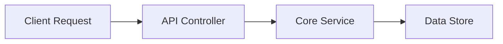

# Feature Specification: Example Feature

> **Standard Compliance**: This document conforms to the [Elephant-Goldfish Model (EGM)](https://egm.dev) Feature Specification Standard.

---

## 1. Problem Statement
Describe the user problem, architectural bottleneck, or business need that motivates this change.

## 2. Goals & Non-Goals
### Goals
- Deliver capability X to solve problem Y.
- Maintain backwards compatibility with existing consumers.

### Non-Goals
- Re-architecting unrelated downstream subsystems.
- Premature optimization for scenarios beyond current requirements.

---

## 3. Proposed Architecture
Detail the component structure, interfaces, and data flow.

### Key Interfaces & Data Contracts
Define function signatures, API payloads, or data schemas.

---

## 4. Evaluation of Alternatives (Mandatory Rule)
EGM enforces a strict evaluation of alternatives before implementation begins.

| Approach | Advantages | Disadvantages | Decision |
| :--- | :--- | :--- | :--- |
| **Option A (Chosen)** | Minimal complexity, high testability | Requires slight API migration | **Adopted** |
| **Option B** | Zero API change | Introduces significant state synchronization overhead | **Rejected** |
| **Option C** | Maximum flexibility | High initial maintenance burden and developer friction | **Rejected** |

---

## 5. Risks, Limits & Mitigations
- **Failure Modes & Edge Cases**: Network partitions, invalid payloads, concurrency races.
- **Security & Privacy**: Access control, data encryption, credential handling.
- **Performance & Scalability**: Latency impact, query indexing, resource utilization limits.

---

## 6. Implementation Plan & Verification
1. Phase 1: Core domain models and unit tests.
2. Phase 2: Service layer implementation and error handling.
3. Phase 3: Integration tests and drift review via `/egm:egm-review`.
